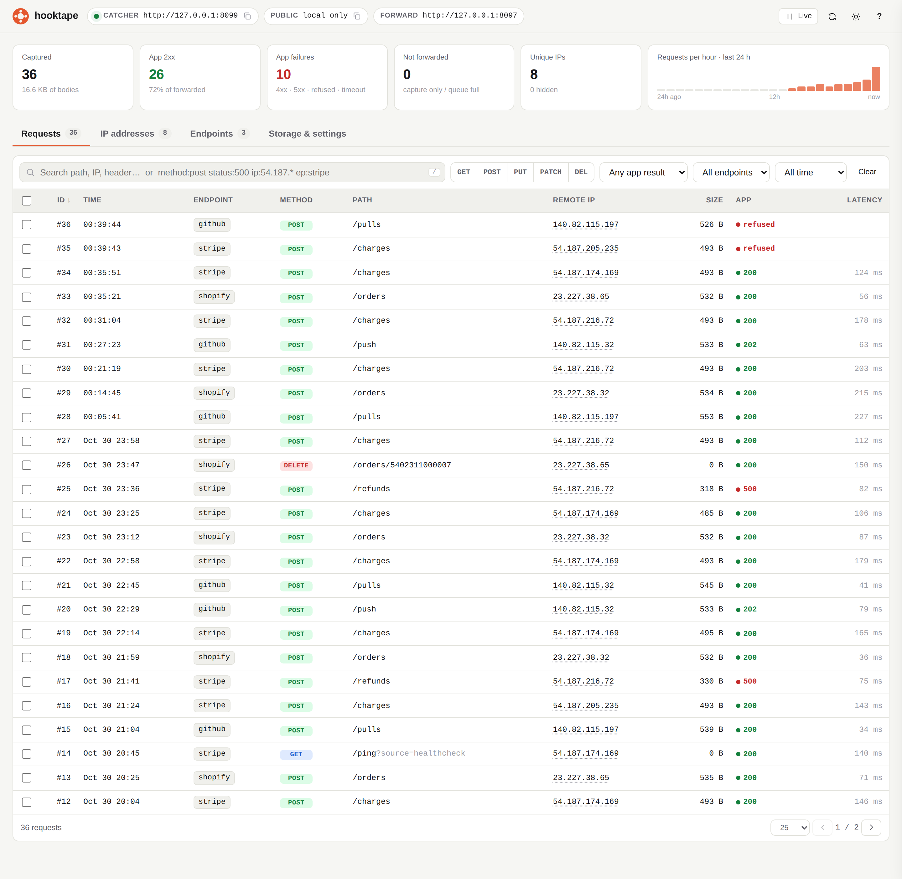
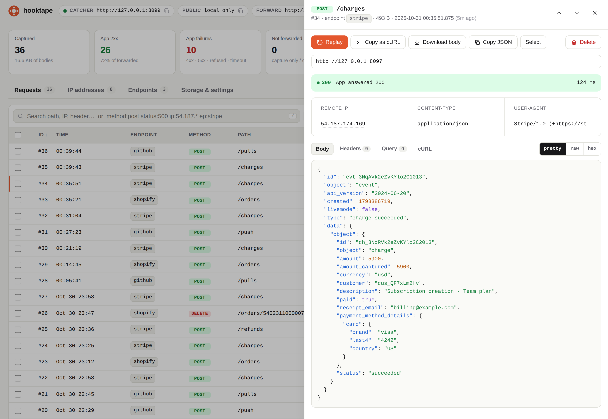
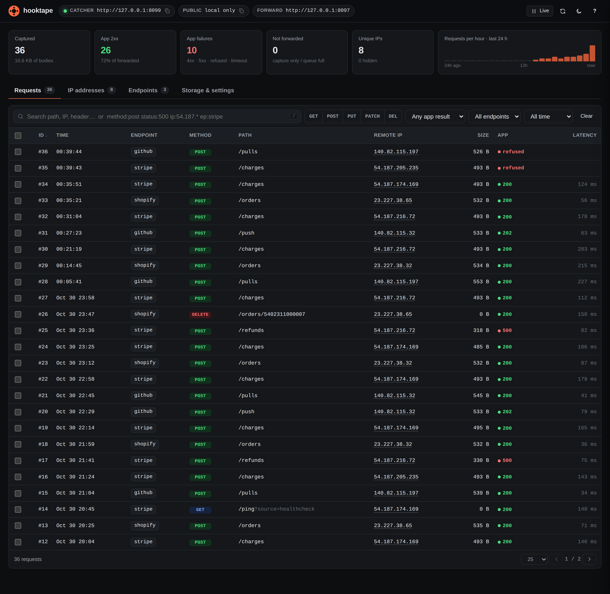

# hooktape

Catch, store, and replay webhooks on your own machine.

A single Go binary. It needs no account and no hosted database. A provider like
Stripe or GitHub posts to a public URL, hooktape writes the request to a local
SQLite file, answers `200` straight away, and forwards it to your app.
When your handler has a bug, you fix the code and replay the same payload, byte
for byte, instead of clicking "pay" in a test dashboard again.



## How it works

The listener that receives webhooks is the catcher. It stores each request,
answers the provider, and forwards the request to your app. A second listener
serves the dashboard, and the CLI reads the same database file.

```
Stripe ─▶ Cloudflare edge ─▶ cloudflared ─▶ catcher 127.0.0.1:8080
                                              │ 1. save to ./hooktape.db
                                              │ 2. reply 200 {"ok":true,"id":N}
                                              └ 3. forward to your app (async)

dashboard 127.0.0.1:8081 ─┐
hooktape list/show/replay ─┴─▶ read ./hooktape.db
```

## Install

### Docker

No Go needed. The image runs on `linux/amd64` and `linux/arm64`:

```sh
docker run -d --name hooktape \
  -p 127.0.0.1:8080:8080 -p 127.0.0.1:8081:8081 \
  -v hooktape-data:/data \
  --add-host=host.docker.internal:host-gateway \
  -e HOOKTAPE_FORWARD=http://host.docker.internal:3000/webhooks \
  mainak58/hooktape --forward http://host.docker.internal:3000/webhooks
```

`--forward` tells `up` where to send each new request, and `HOOKTAPE_FORWARD`
tells `docker exec` replays where to send it, because the flag doesn't reach
`exec` and the remembered target is lost when the container is recreated.

Send requests to `http://localhost:8080/h/<endpoint>` and open the dashboard at
<http://localhost:8081>. To run the other commands:

```sh
docker exec hooktape hooktape list
docker exec hooktape hooktape replay 1
docker exec hooktape hooktape delete --all --yes
```

`delete` needs `--yes` here. Plain `docker exec` has no interactive stdin to
answer its prompt, so without it you get `Error: nothing deleted`.

If your app runs in Compose, forward to its service name instead:

```yaml
services:
  hooktape:
    image: mainak58/hooktape:v0.1.0
    ports:
      - "127.0.0.1:8080:8080"
      - "127.0.0.1:8081:8081"
    volumes:
      - hooktape-data:/data
    environment:
      HOOKTAPE_FORWARD: http://app:3000/webhooks
    command: ["--forward", "http://app:3000/webhooks"]
    restart: unless-stopped

  app:
    build: .

volumes:
  hooktape-data:
```

Both targets above are hostnames, so `replay` and dashboard replays drop
`Authorization` and `Cookie` (see [What gets forwarded](#what-gets-forwarded)).
Add `--keep-credentials` to `replay`, or point the dashboard's replay target at
the IP address. Automatic forwards keep them.

A replay right after `docker compose up -d` can fail with `connection refused`
while your app is still starting. Run it again once the app is up.

Inside the container, `localhost` means the container itself, so `--forward` needs
`host.docker.internal` or a service name to reach your app.

Keep `127.0.0.1` in the dashboard's port mapping: the dashboard has no login. The
startup log warns that anyone on the network can reach it because the container
listens on every interface; the port mapping is what limits that. The image has
no cloudflared, so it has no public URL of its own.

### Go

```sh
go install github.com/mainak58/hooktape/cmd/hooktape@latest
```

Go 1.26 or newer (see `go.mod`). The build is pure Go (no cgo, no system
libraries). The first install compiles SQLite, so it can take a few minutes.

If `hooktape` isn't found after installing, add Go's bin directory to your
`PATH`:

```sh
export PATH="$PATH:$(go env GOPATH)/bin"
```

Or from a clone:

```sh
make build     # builds ./hooktape
```

[cloudflared](https://developers.cloudflare.com/cloudflare-one/connections/connect-networks/downloads/)
is optional and gets you a public HTTPS URL. Without it, everything still works
for callers that can already reach your machine: curl, Postman, a container on
the same host.

## Quickstart

1. Start it, pointing at your app's webhook handler.

   ```sh
   hooktape up --forward http://localhost:3000/webhooks
   ```

   ```
   hooktape up
     db        ./hooktape.db
     catcher   http://127.0.0.1:8080/h/<endpoint>/...
     forward   http://localhost:3000/webhooks
     dashboard http://127.0.0.1:8081
     public    https://wide-tiger-cups.trycloudflare.com
     paste →   https://wide-tiger-cups.trycloudflare.com/h/demo
   ```

2. Paste the `paste →` URL into the provider's dashboard as the webhook endpoint.
   Any name after `/h/` works (letters, digits, `-` and `_`, up to 64
   characters), so give each provider its own: `/h/stripe`, `/h/github-dev`.
   Any other name gets a `400`, and an empty one gets a `404`.

3. Trigger an event. Each event prints two lines, one for the incoming request
   and one for your app's response:

   ```
   ← #1 POST /  28 B
   → #1 POST /  200 12ms
   ```

4. Open the dashboard at <http://127.0.0.1:8081> to read bodies, search, and
   replay. Or stay in the terminal:

   ```sh
   hooktape list            # newest first
   hooktape show 1          # headers + pretty-printed body
   hooktape replay 1        # send it to your app again
   ```

   ```
   ID  TIME      ENDPOINT  METHOD  PATH  SIZE  APP
   2   00:28:04  github    POST    /     19 B  200
   1   00:28:04  stripe    POST    /     28 B  500 ↻200
   ```

   `↻200` is the latest replay. The `500` stays, so the original delivery is
   never overwritten.

Everything lives in `./hooktape.db`. Requests stay there until you delete them:
nothing expires. See [Deleting requests](#deleting-requests), or copy the file to
keep a set of requests around.

## The dashboard

`hooktape up` serves a dashboard on a second port (`--ui-port`, default 8081, and
`--no-ui` turns it off). The page is embedded in the binary, so there is nothing
to install and no internet connection involved. It refreshes every 3 seconds
while the tab is visible.

- The Requests tab is a live table. Click a row for its headers, query
  parameters, and body as pretty JSON, raw text, or a hex dump. You can copy any
  request as a `curl` command, and replay or delete a single row or a selection.
- The IP addresses tab groups callers by address, with a filter that hides your
  own machine so a provider's retries stand out.
- The Endpoints tab lists every `/h/<name>` used so far, its busiest paths, and
  the full URL to paste.
- Storage & settings shows the database path and uptime, and deletes in bulk:
  older than an hour, a day, 7 days, 30 days, or everything. Nothing is deleted
  unless you ask.

Replay from the page goes to the target set in Storage & settings, which is saved
in this browser. Until you set one it starts at the `--forward` URL, or
`http://localhost:3000` if there is none, so check it before you click. The page
has no `--keep-credentials` and doesn't warn when a replay drops `Authorization`
and `Cookie` (see [What gets forwarded](#what-gets-forwarded)). To keep them, use
`localhost` or a loopback or private IP address as the target.

Search takes plain words and filters: `method:post`, `status:5xx`,
`status:failed`, `ip:54.187.*`, `ep:stripe`, `id:42`, `path:/charges`,
`header:x-hub-signature`. A leading `-` excludes, so `-ip:127.0.0.1` hides local
calls. Press `/` to search, `j` and `k` to walk the list, `p` to replay the open
request, `l` to pause live updates, and `?` for the full shortcut list.

Click any row to open it. The drawer shows the forward result, the latest replay,
the request metadata, and the body as pretty JSON, raw text, or a hex dump:



<details>
<summary>Dark theme</summary>



</details>

Header values that look like secrets (`authorization`, `*signature*`, `*token*`,
`*secret*`, `api-key`, `hmac`, cookies) stay blurred until you hover them, so the
page is safe to screen-share. You can turn that off in Storage & settings.

## Commands

| Command | What it does |
| --- | --- |
| `hooktape up` | Catch, store, forward, serve the dashboard, optionally open a tunnel |
| `hooktape list` | Table of captured requests, newest first |
| `hooktape show <id>` | One request in full |
| `hooktape replay <id>...` | Re-send stored requests to your app |
| `hooktape delete` | Remove requests by id, date range, age, or endpoint |
| `hooktape version` | Version and commit |

### `up`

| Flag | Default | What it does |
| --- | --- | --- |
| `--forward` | _(none)_ | URL of your app. Leave it out to capture only. |
| `--forward-path` | off | Append the path after `/h/<endpoint>` to the forward URL, here and on dashboard replays. See [What gets forwarded](#what-gets-forwarded). |
| `--forward-workers` | `1` | Forwards sent at once. Above 1, arrival order is not kept. |
| `--port` | `8080` | Catcher port. |
| `--addr` | `127.0.0.1` | Interface for the catcher. |
| `--ui-port` | `8081` | Dashboard port. |
| `--ui-addr` | `127.0.0.1` | Interface for the dashboard. |
| `--no-ui` | off | Don't serve the dashboard. |
| `--replay-any-host` | off | Let the dashboard replay to public hosts, not just loopback and private addresses. |
| `--hint` | `demo` | Endpoint name used in the `paste →` hint. Routing accepts any name regardless. |
| `--respond` | `200` | Status returned to the provider, 200 to 599. |
| `--timeout` | `10s` | Per-forward timeout. |
| `--max-body` | `1MB` | Largest body to keep. `1MB` is 1,000,000 bytes, and it must be above 0. See [Limits and gotchas](#limits-and-gotchas). |
| `--no-tunnel` | off | Don't start cloudflared. |
| `--tunnel-name` | _(none)_ | Use a named tunnel instead of a quick one. |

### `list`, `show`, `replay`

```sh
hooktape list --limit 10 --endpoint stripe
hooktape list --watch              # reprint every 2s
hooktape list --json               # JSON array, no bodies

hooktape show 12 --headers-only
hooktape show 12 --body-only
hooktape show 12 --raw > body.bin  # exact bytes

hooktape replay 12
hooktape replay 3 4 5 --forward http://localhost:3000
hooktape replay 12 --timeout 30s
hooktape replay 12 --forward-path        # append the stored path to the target
hooktape replay 12 --keep-credentials    # keep Authorization and Cookie on a non-local target
```

`replay` takes its target from `--forward`, then `$HOOKTAPE_FORWARD`, then the
last URL that got a response from `up` or `replay` (remembered in `config.json`
in your user config directory). It exits non-zero if any request failed, came
back non-2xx, or has an unknown id, which makes it usable in a script. An unknown
id does not stop the rest of the list.

A replay never overwrites the original delivery. `show` prints both, as `app:`
and `replay:`, and only the latest replay is kept.

`list`, `show`, `replay`, and `delete` need an existing database. If the `--db`
file is missing or empty they say so rather than creating one. A database from an
older hooktape is upgraded the first time any command opens it, and every stored
request stays readable. An older hooktape cannot read the rows written after that.

### Global flags

These work on every command: `--db` (default `./hooktape.db`, or
`$HOOKTAPE_DB`), `--no-color`, and `--verbose` / `-v`. On `up`, `-v` prints each
request body after it is forwarded, plus cloudflared's raw output. On `replay`,
it prints your app's response body.

## Deleting requests

Requests are kept until you remove them. There is no retention window and nothing
expires, so `delete` is the only way a request goes away, along with the
dashboard's delete buttons and removing the file yourself.

```sh
hooktape delete 12 13 14                            # these ids
hooktape delete --from 2026-01-01 --to 2026-03-31   # a date range, both days included
hooktape delete --from "2026-03-01 09:00" --to "2026-03-01 17:30"
hooktape delete --from 2026-06-01                   # that day onward
hooktape delete --to 2026-01-01                     # everything up to the end of that day
hooktape delete --older-than 30d                    # or 48h
hooktape delete --endpoint stripe                   # one endpoint
hooktape delete --endpoint stripe --from 2026-01-01
hooktape delete --all
```

Dates are local time, in any of these forms: `2026-03-31`, `2026-03-31 15:04`,
`2026-03-31 15:04:05`, `2026-03-31T15:04`, `2026-03-31T15:04:05`, or RFC 3339
(`2026-03-31T15:04:05+05:30`). `--from` is inclusive. A `--to` with only a date
covers that whole day, and a `--to` with a time includes that moment.

Run it with no selector and it refuses. Ids cannot be mixed with filters, `--all`
stands alone, and `--older-than` cannot be mixed with `--from` or `--to`.

It shows the count and asks `[y/N]` first. `--yes` / `-y` skips the question,
which a script or a plain `docker exec` needs because anything other than yes
aborts with exit 1. `--dry-run` prints the count and deletes nothing.

Requests that arrive after a delete starts are kept, unless a `--to` reaches past
that moment.

After deleting, `delete` compacts the file, so the disk space comes back and the
deleted secrets are gone from it. If that step fails, or another process is
reading the database, you get a warning and the requests are still deleted; run
the command again once it is idle. The dashboard's delete buttons skip this step,
so the file keeps its size and its old bytes until the next `hooktape delete`,
which compacts even when it matches nothing. Compacting a very large database
holds up incoming webhooks while it runs, and they are saved when it finishes.

## Public URLs

With cloudflared installed, `up` starts a quick tunnel and prints an HTTPS URL.
Quick tunnels are free and need no login, but the hostname changes on every
restart, which is fine while you are debugging and annoying when a provider makes
you re-verify the URL.

For a URL that stays put, create a named tunnel once:

```sh
cloudflared tunnel login
cloudflared tunnel create hooktape
cloudflared tunnel route dns hooktape hooks.example.com
```

Then start hooktape with that tunnel:

```sh
hooktape up --tunnel-name hooktape --forward http://localhost:3000/webhooks
```

A named tunnel's hostname is set in Cloudflare, not in hooktape, so `up` prints
no `paste →` hint for it. Build the URL from your own hostname:
`https://hooks.example.com/h/stripe`.

If cloudflared is missing or fails to start, `up` reports it and keeps catching
locally. The tunnel is optional.

## What gets forwarded

The stored request is replayed as faithfully as a proxy can:

- Same method, body bytes, and query string, sent to your `--forward` URL exactly
  as given. The path after `/h/<endpoint>` is stored and shown, but not sent,
  because anyone holding the public URL controls it.
- All headers except hop-by-hop ones (`Connection`, `Transfer-Encoding`, and so
  on), `Host`, `Content-Length`, `Accept-Encoding`, `Expect`, and Cloudflare's
  `Cf-*`. Signature headers are kept untouched, so your verification code runs
  for real.
- Plus `X-Hooktape-Id: <id>`, and `X-Hooktape-Replay: true` on replays, so your
  app can tell a replay apart if it wants to. Go's HTTP client also adds
  `Accept-Encoding: gzip`, and a `User-Agent` if the sender didn't set one.
- A CLI or dashboard replay drops `Authorization` and `Cookie` unless the target
  is `localhost` or a loopback or private IP address. This is a text check with
  no DNS lookup, so a hostname such as `host.docker.internal` or a Compose service
  name counts as non-local even when it resolves to a private address.
  `hooktape replay --keep-credentials` sends them. The dashboard has no such
  option, so point its replay target at the IP address. Automatic forwards always
  keep them, and signature headers and `X-Api-Key` are not dropped.

Point `--forward` at one handler, or opt in to path pass-through if your app
routes on the path:

```sh
# /h/stripe and /h/stripe/charges both reach /webhooks/stripe
hooktape up --forward http://localhost:3000/webhooks/stripe

# /h/stripe/charges reaches /charges
hooktape up --forward http://localhost:3000 --forward-path
```

With `--forward-path`, anyone holding the public URL can reach every path on your
app with any method. A path containing `..` is still stored, but is not sent.
`replay` takes the same flag.

Forwarding happens after the provider has been answered, in arrival order, one at
a time unless you raise `--forward-workers`, and redirects are not followed. If
your app is down, the request is already saved: fix the app and `replay`.

## Limits and gotchas

- Nothing is caught while your laptop is asleep or offline, because hooktape
  runs locally. A provider's retries may cover the gap, but check its docs.
- Late replays can fail signature checks. Many providers sign a timestamp and
  reject anything older than a few minutes. The replay sends the same body and
  signature headers, so a rejection means your signature check works.
- A replay to a non-local target can fail auth because `Authorization` and
  `Cookie` were dropped. See [What gets forwarded](#what-gets-forwarded).
- A body over `--max-body` is cut to that size and stored with a truncated flag,
  and the provider gets `413` whatever `--respond` says. A truncated row is never
  forwarded or replayed, since your app would only see half a payload. Raise the
  limit (`--max-body 5MB`) if a provider sends large payloads.
- A body has 30 seconds to arrive. One that is cut off by that limit or by a
  hang-up keeps the bytes that did arrive, as a truncated row, and the provider
  gets `400`.
- Request headers are limited to `--max-body`, at least 64 KiB and at most 1 MiB.
- The forward queue holds 256 requests. If a slow app fills it, further requests
  are still saved, and the log names the id so you can `hooktape replay` it by
  hand.
- Two `up` commands can share one `--db`. Both catch into the same file, so their
  ids interleave.

## Security

- The catcher and the dashboard both listen on `127.0.0.1` by default. `--addr`
  moves only the catcher; the dashboard leaves loopback only with `--ui-addr`. The
  tunnel exposes only the catcher port, so the dashboard (which can delete and
  replay) is not reachable inbound from the internet.
- A web page open in your browser cannot drive the dashboard either. Cross-origin
  `POST`s are refused, the API requires `Content-Type: application/json`, and the
  `Host` header must be an IP address or `localhost`, which stops DNS rebinding.
- Dashboard replays reach only loopback and private addresses, checked against
  the IP actually dialled, unless you pass `--replay-any-host`.
- Through the tunnel, only `/h/*` stores anything. `GET /_health` answers `ok`,
  and every other path returns `404`, or a redirect if it needs cleaning up.
- Requests are stored as they arrived, so `hooktape.db` holds real signatures,
  tokens, and customer data in a plain file with no encryption. The file is
  readable only by your user on Linux and macOS, and `*.db` is gitignored here, but treat it as a
  secret and clear it with `hooktape delete --all` when you are done (add `--yes`
  under `docker exec`). Requests that arrive after it starts are kept, so run it
  once traffic has stopped.
- Anything that can reach the catcher port can write to your database and trigger
  a forward, so avoid `--addr 0.0.0.0` on a shared network. The dashboard has no
  login, so a non-loopback `--ui-addr` lets anyone who can reach it read, delete,
  and replay.

## Development

```sh
make test      # go test -race ./...
make lint      # gofmt check + go vet
make run ARGS="up --no-tunnel"
```

Pure Go, no cgo, so `CGO_ENABLED=0 go build ./...` works on every platform. The
dashboard page lives at `internal/web/index.html` and is compiled into the binary
with `go:embed`. The JSON API it reads is listed in a comment at the top of that
file's script block.

## License

MIT. See [LICENSE](LICENSE).
